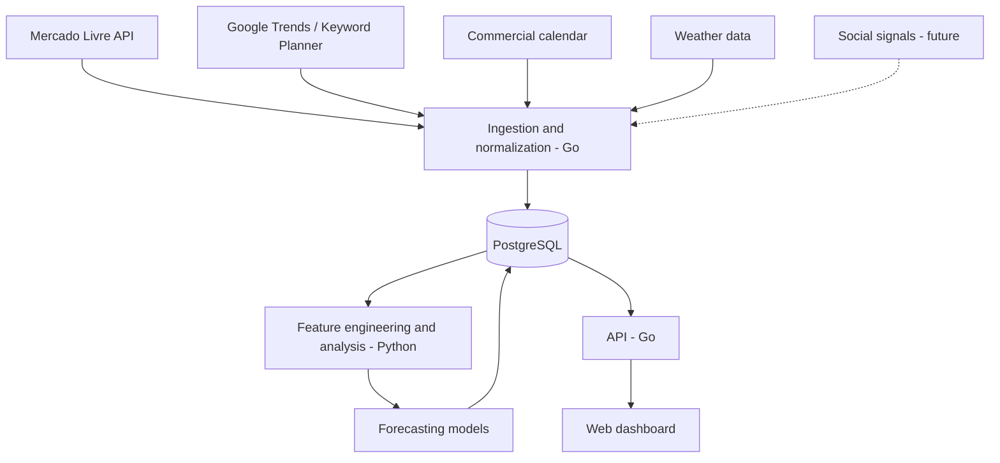

# Market Trend Predictor

> A personal market intelligence tool for anticipating product and category trends on Mercado Livre and supporting inventory purchasing decisions for resale.


## Overview

**Market Trend Predictor** is a data engineering and machine learning project designed to answer one question:

**Which product categories are most likely to experience growing interest over the coming weeks, before they reach peak popularity?**

The tool will combine Mercado Livre signals, search interest, seasonality, commercial calendars, and weather to identify opportunities worth investigating. It is built for **personal use**: researching markets, comparing hypotheses, and making better-informed decisions before investing in inventory.

This project is **not** a SaaS platform. It does not promise sales, and it will not present unsupported revenue estimates as facts.

## Goals

- Identify categories and keywords showing signs of increasing interest.
- Anticipate trends with an initial **30-day** forecasting horizon, with potential 15- and 60-day experiments later.
- Explain the signals behind each forecast and communicate uncertainty.
- Track previous predictions and measure their accuracy over time.
- Assess promising categories using prices, competition, and costs to decide **what is worth researching for resale**.

## How It Works

1. **Ingestion:** connectors fetch data from official or otherwise permitted sources while respecting authentication, quotas, and terms of use.
2. **Normalization:** observations from multiple sources are mapped to timestamps, regions, search terms, and Mercado Livre categories.
3. **History:** permitted observations and snapshots are retained to build time series.
4. **Analysis:** the system derives growth, seasonality, volatility, anomalies, and contextual indicators.
5. **Forecasting:** statistical and machine learning models rank categories by potential future growth.
6. **Evaluation:** recorded predictions are compared with later observations using time-aware backtesting.
7. **Exploration:** a personal dashboard displays rankings, visualizations, supporting evidence, and profitability scenarios.



## Data Sources

| Source | Data of interest | Intended purpose | Important considerations |
| --- | --- | --- | --- |
| **Mercado Livre API** | Trends, category rankings, catalog, and accessible listing information | Marketplace popularity signals | Validate endpoint permissions, coverage, and retention rules |
| **Google Trends** | Relative search interest and seasonality | Detect acceleration in search interest | Official API access is restricted; evaluate permitted alternatives |
| **Google Ads Keyword Planner** | Historical keyword search volume estimates | Complement interest time series | Requires access and setup for the Google Ads API |
| **Commercial calendar** | Holidays, retail dates, and relevant events | Known seasonal predictors | Include Brazilian dates and movable holidays |
| **Open-Meteo** | Historical and forecast temperature and precipitation | Context for weather-sensitive product categories | Respect API terms and limits |
| **YouTube / TikTok** | Public popularity and emerging-topic signals | Later experiments | API access and permitted usage vary by platform |

**Important:** rankings, searches, and engagement are *proxies* for interest; they are not direct measures of units sold or revenue. No integrations have been implemented yet.

## Forecasting Strategy

The first version will aim to forecast **relative growth in category-level search interest**, using weekly observations and a four-week prediction window. Mercado Livre rankings and trends will provide supporting signals and, as historical coverage grows, additional features and validation opportunities.

### Candidate Features

- Changes in search interest over the previous 1, 4, and 8 weeks.
- Monthly seasonality and comparisons with equivalent periods in previous years.
- Frequency and movement of related terms in Mercado Livre signals.
- Days until holidays or relevant commercial events.
- Regional temperature, precipitation, and weather anomalies.
- Competition and pricing indicators, where legally and technically available.

Mapping search terms to categories requires explicit rules and a semantic matching layer for ambiguous cases. A search term does not necessarily refer to a single product category.

### Models and Evaluation

Start with simple models, increasing complexity **only when justified by the data**:

1. **Baselines:** persistence and historical seasonal patterns.
2. **Classical approaches:** regression and time-series models such as SARIMAX.
3. **Machine learning:** LightGBM or XGBoost for combining external signals.
4. **Later research:** more complex models and emerging-trend detection.

Use **walk-forward temporal validation**, ensuring that each forecast only uses information available at its prediction cutoff. Evaluation will include **Precision@10** for category rankings, appropriate forecast error metrics, and consistent comparisons against baselines.

Each forecast should retain its issue date, horizon, model version, input information, and subsequently observed outcome.

## Planned Tech Stack

| Layer | Technology | Responsibility |
| --- | --- | --- |
| Collectors and API | **Go** | Integrations, workers, endpoints, and business logic |
| Analytics and ML | **Python** | Pandas/Polars, feature engineering, training, and backtesting |
| Database | **PostgreSQL** | Historical time series, categories, and forecast records |
| Frontend | **Next.js + TypeScript** | Personal dashboard and opportunity exploration |
| Local environment | **Docker Compose** | Reproducible development environment |
| Possible future infrastructure | **Kubernetes** | Scheduled jobs, services, and observability in a homelab |

**Architecture principle:** start with a small number of well-defined components. Kubernetes, queues, Redis, TimescaleDB, and additional services remain optional until a real need emerges.

## Planned Features

- **Trend Explorer:** explore categories, keywords, and changes in interest.
- **Category Forecast:** estimate the probability and magnitude of near-term category growth.
- **Seasonality View:** visualize annual cycles and related events.
- **Opportunity Watchlist:** track categories and products under investigation.
- **Prediction History:** compare past forecasts with actual subsequent observations.
- **Profit Calculator:** model margins, costs, marketplace fees, and capital needed for a small inventory test.
- **Opportunity Ranking (future):** combine forecast trends with commercial feasibility without confusing popularity with profitability.

## Repository Structure and Development Workflow

Development follows **Spec-Driven Development (SDD)**. Each meaningful stage is documented under `specs/<number>-<stage-name>/` before implementation, using three required files: `spec.md` (requirements), `plan.md` (technical approach), and `tasks.md` (execution checklist).

```text
market-trend-predictor/
├── specs/
│   ├── 001-data-ingestion/       # Example stage name, not a fixed roadmap
│   │   ├── spec.md
│   │   ├── plan.md
│   │   └── tasks.md
│   └── 002-data-normalization/  # Example stage name, not a fixed roadmap
│       ├── spec.md
│       ├── plan.md
│       └── tasks.md
├── src/
├── AGENTS.md
└── README.md
```

Stage names above are illustrative. Refer to [`AGENTS.md`](AGENTS.md) for the complete coding-agent workflow and engineering rules.

## Roadmap

- [ ] **Phase 1 — Foundation:** repository setup, local configuration, database, and first Mercado Livre integration.
- [ ] **Phase 2 — Historical data:** scheduled collection, search signals, calendar and weather ingestion, and category normalization.
- [ ] **Phase 3 — Analysis:** growth and seasonality metrics plus an exploratory dashboard.
- [ ] **Phase 4 — Forecasting:** baselines, models, backtesting, and stored predictions.
- [ ] **Phase 5 — Purchasing decisions:** watchlist, opportunity comparisons, and profitability calculator.
- [ ] **Phase 6 — Expansion:** evaluate social signals, additional horizons, and optional Kubernetes deployment.

## Project Principles

- **Data before AI:** credible forecasting starts with reliable and well-understood data.
- **Testable predictions:** each hypothesis must be measurable against later outcomes.
- **No false certainty:** expose each signal's source, observation date, coverage, and uncertainty.
- **No temporal leakage:** never use data that was unavailable at prediction time.
- **Simplicity first:** avoid unnecessary infrastructure in a personal project.
- **Respect source policies:** comply with API quotas, authentication, storage, and redistribution restrictions.

## Current Status

**Planning and architecture definition.** There is no runnable application yet. Setup and run instructions will be added after the first integration is implemented.

## References

- [Mercado Livre Developers](https://developers.mercadolivre.com.br/)
- [Google Trends](https://trends.google.com/)
- [Google Ads API](https://developers.google.com/google-ads/api)
- [Open-Meteo](https://open-meteo.com/)
- [YouTube Data API](https://developers.google.com/youtube/v3)

---

> **Disclaimer:** forecasts represent interest signals and market hypotheses, not guarantees of demand, sales, or profit.
